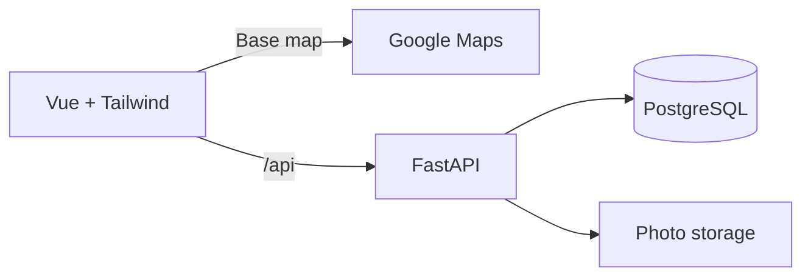

# Akses Campus

A campus accessibility finder helping wheelchair users check facilities and recent barrier reports before visiting.

Built as a planned three-person, 24-hour hackathon project under the Persons with Disabilities track. IIUM is the proposed pilot campus.

> Where can I study nearby with a step-free entrance and an accessible toilet, and how recently was that information checked?

## Status

**Planning and documentation only.** There is no runnable application, database schema, dependency manifest, seed dataset, or deployment yet. The stack and structure below describe the implementation baseline.

Teammates and future agents should read [onboarding.md](onboarding.md) for scope, judging criteria, related work, acceptance criteria, responsibilities, and engineering guidance.

## Planned MVP

- Explore approximately 10–15 campus locations using a Google map or accessible list.
- Filter for step-free entrances, accessible toilets, and designated parking.
- View facility observations, evidence, source, and last checked date.
- Submit temporary barrier reports, clearly labelled as unverified.
- Let an authenticated reviewer confirm, reject, or resolve reports with status history.

Facilities use **yes / no / unknown** values. Permanent observations and temporary barriers remain separate records.

**Demo flow:** Find a study location -> inspect evidence -> report a blocked ramp -> display the warning -> reviewer confirms and later resolves the report.

Route planning, volunteer dispatch, city-wide coverage, and AI accessibility certification are outside the MVP. Natural-language search is optional after the core flow works.

## Technology stack

| Area | Baseline |
| --- | --- |
| Frontend | Vue 3, Vite, JavaScript, Vue Router |
| Styling | Tailwind CSS with the Vite plugin |
| Map | Google Maps JavaScript API, Advanced Markers |
| Backend | Python, FastAPI, Pydantic |
| Database access | SQLModel |
| Database | PostgreSQL |
| Images | Object storage; provider undecided |
| Optional AI | Backend service translating search requests into visible filters |

Use one repository and one backend, organized by feature. Google provides the base map; our database provides coordinates, accessibility evidence, and reports.



During development, Vite will proxy `/api` to FastAPI. The production plan is to serve the built frontend and API from the same FastAPI service and public origin. Hosting is not selected yet.

## Planned project structure

Only the documentation files exist today; application directories will be created during implementation.

```text
frontend/src/
  components/
  views/
  composables/
  services/
backend/app/
  main.py
  models.py
  schemas.py
  database.py
  routers/
  services/
seed/
README.md
onboarding.md
```

## Setup readiness

Installation and startup commands will be added once the scaffold and dependency manifests exist. Do not assume `npm run dev` or a Python entry point is available yet.

Before implementation, prepare:

1. Node.js compatible with the selected Vite release and a Python version supported by the pinned backend dependencies.
2. A PostgreSQL database and backend-only connection URL.
3. A Google Cloud project with billing enabled, Maps JavaScript API enabled, a map ID, and a browser key restricted to approved websites and the required API.
4. A photo-storage provider if uploads are included, and a reviewer-authentication implementation.

Proposed configuration names, to finalize when scaffolding:

| Variable | Side | Purpose |
| --- | --- | --- |
| `VITE_GOOGLE_MAPS_API_KEY` | Browser | Restricted, browser-visible map key |
| `VITE_GOOGLE_MAPS_MAP_ID` | Browser | Map ID for Advanced Markers |
| `DATABASE_URL` | Backend | PostgreSQL connection string; secret |
| `SESSION_SECRET` | Backend | Session signing secret if session authentication is selected |

All `VITE_*` variables are public build configuration. Never place database, storage-service, reviewer, or AI secrets in them. Add `.env.example` files with placeholders and ignore real `.env` files when the scaffold is created.

## Google Maps cost

As checked on **16 October 2026**, global Dynamic Maps pricing includes **10,000 free loads per month**, then **US$7 per 1,000 additional loads** through 100,000 monthly loads. Usage is aggregated across projects on the billing account; taxes and other services are excluded. Billing setup is still required. [Official pricing](https://developers.google.com/maps/billing-and-pricing/pricing)

Custom markers, panning, and zooming do not add map loads; recreating the map does. Places search, geocoding, and directions can incur separate charges. Use stored campus coordinates for the MVP. [Billing FAQ](https://developers.google.com/maps/faq)

## Quality and responsible use

- Keep the list and report flow usable with a keyboard and without the map.
- Pair status colors with labels and show unknown information explicitly.
- Label sample data and unverified reports honestly; reviewer confirmation is not accessibility certification.
- Enforce reviewer permissions and report transitions on the backend.
- Verify persistence, filtering, authorization, report history, and the deployed demo flow.
- Avoid collecting disability histories or requiring precise live location.

No build or application tests have run because implementation has not started. Add actual build, lint, test, seed, and deployment commands as they become available.

## Related work

Existing work includes [Wheelmap](https://news.wheelmap.org/en/), [AccessNow](https://accessnow.com/), [AccessAble university guides](https://www.accessable.co.uk/inspire-me/heading-to-uni), and [IIUM's 2023 accessibility mapping initiative](https://news.iium.edu.my/enhancing-iium-accessibility-empowering-students-of-all-abilities/).

The proposed project angle is campus-specific evidence and a visible report-review-resolution workflow. This is a hypothesis to validate, not a claim that competitors lack these features. See [the onboarding research comparison](onboarding.md#related-work-and-evidence) for sources and limitations.
