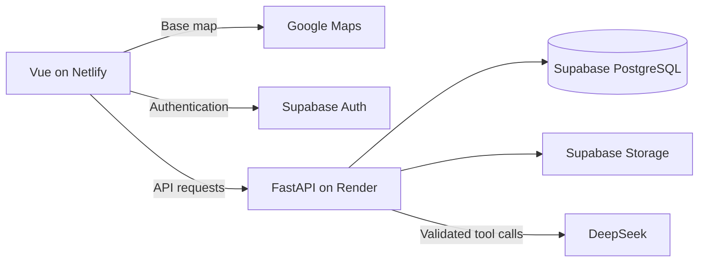

# Akses Campus

A campus accessibility finder with an AI assistant helping wheelchair users find facilities and check recent barrier reports before visiting.

Built as a planned three-person, 24-hour hackathon project under the Persons with Disabilities track. The confirmed pilot is **IIUM Gombak**, with an **English-only** interface initially. The data model should allow additional campuses later.

> Where can I study nearby with a step-free entrance and an accessible toilet, and how recently was that information checked?

## Status

The agreed experimental policy is `iium-gombak-pilot-v1`: at least 3 supporters, support weight at least 3, at least 67% supporting weight, and a maximum weight of 2 per vote. Everyone starts at 1; higher-weight assignment remains unagreed. Local ignored settings select this version, while committed defaults keep voting disabled. Restart the backend to reload it. Named policy selection is on the current review branch; shared deployment remains pending. See [policy configuration](backend/README.md#agreed-pilot-policy-configuration).

**Backend features implemented; external integration pending.** FastAPI includes health/docs, building discovery, Supabase JWT verification, DeepSeek chat orchestration, signed-in reports/votes/clearing observations, and explicitly configured trust rules. Building browsing now connects to PostgreSQL when `DATABASE_URL` is configured; SQL-backed list/details and warnings are verified locally in the Vue browser. Transactional community persistence is implemented on the current review branch and verified against disposable PostgreSQL; trust-policy activation, provider setup, chat/clearance UI and shared deployment remain pending; disconnected features return explicit 503s. See [backend startup instructions](backend/README.md#local-development) and [team handoff/review order](BACKEND_HANDOFF.md).

Teammates and future agents should read [onboarding.md](onboarding.md) for scope, judging criteria, related work, acceptance criteria, responsibilities, and engineering guidance.

For chatbot testing before Supabase is connected, use the explicitly enabled [local demo mode](backend/README.md#local-chatbot-demo-without-supabase). It provides fictional labelled buildings and real DeepSeek responses, is disabled by default, and cannot run in production. This does not connect the real database or simulate community writes.

Read [COLLABORATION.md](COLLABORATION.md) before editing: teammate 1 owns `frontend/`; the user owns backend/API and integration; teammate 3 owns `supabase/`, `seed/`, and backend database/model modules. Use task branches and small PRs. [AGENTS.md](AGENTS.md) applies the same ownership boundaries to coding agents. Shared interface decisions belong in [contracts/](contracts/README.md).

PR verification: [Backend tests](.github/workflows/backend.yml) runs the Python 3.12 suite and dependency checks without external-service secrets. Review the `Python 3.12 backend tests` check and downloadable JUnit results before merging. Branch protection and automatic merging are not configured by this workflow.

## Planned MVP

- Explore approximately 10–15 campus buildings using a Google map or accessible list, with specific entrance details inside each building record.
- Filter for step-free entrances, accessible toilets, and designated parking.
- View facility observations, evidence, source, and last checked date.
- Ask the AI assistant to find matching places or explain a location's recorded accessibility; show source cards and update the map/list from structured results.
- Submit temporary barrier reports, clearly labelled as unverified.
- Let signed-in community members corroborate, dispute, or report that a barrier has cleared; derive report status from bounded weighted votes and preserve history.

Facilities use **yes / no / unknown** values. Permanent observations and temporary barriers remain separate records.

Browsing is public; reports and votes require sign-in. Buildings that match facility filters stay visible when a barrier is reported, with a prominent warning. Campus records will be collected by the team through on-site observation; user validation has not happened yet.

**Demo flow:** Ask for a study space with a step-free entrance and accessible toilet -> see matching buildings and evidence cards -> inspect a barrier warning -> submit a report -> other community members corroborate it -> subsequent clearing observations resolve it.

## Community verification

The project uses community verification rather than a dedicated reviewer role. The planned algorithm gives new accounts neutral weight and established contributors a capped weight advantage. Reliability scores are internal; contribution rules and restrictions must still be understandable to users.

- Require multiple distinct voters; no self-voting or duplicate votes.
- Use onboarding guidance and lower submission limits for new accounts.
- Show conflicting reports as disputed. Community agreement is not proof of truth or a guarantee of accessibility.
- Apply rate limits or temporary restrictions to suspicious activity; do not silently discard every low-score user's report.
- Treat a barrier clearing as a later event, not proof that its original reporter was wrong.
- Keep weighting rules configurable and experimental; thresholds, bootstrap rules, and reputation updates must be finalized before implementation.

See [community verification details](onboarding.md#community-verification-and-trust) for the implementation boundaries.

Route planning, volunteer dispatch, city-wide coverage, and AI accessibility certification are outside the MVP. The backend chatbot is implemented over the working place/search API; frontend and live-service integration remain pending. Conversational report drafting is a stretch feature.

## AI assistant

The assistant is grounded in campus records and exposes two initial tools: `search_places` and `get_place_details`. It can interpret search requirements, return matching locations, and explain known facilities and active warnings. The frontend displays editable interpreted filters, matching markers, and source cards with observation dates and report status.

The integration flow is `Vue chat panel -> POST /api/chat -> backend-validated tool call -> database query -> answer + cards + map/list updates`. The backend endpoint and tool schemas are implemented in [the chat contract](contracts/chat.md); the configured place adapter is implemented; frontend chat wiring and external provider verification remain pending.

- The backend allows only explicitly defined tools and validates arguments. The model cannot run arbitrary SQL, vote, change report status, or modify reputation.
- Answers must distinguish unknown facilities and unverified reports; missing evidence must not become a confident accessibility claim.
- Place descriptions and submitted reports are untrusted content, never instructions for the model.
- If there is no complete match, say so and show explicitly labelled partial matches or ask which requirement to relax. Never silently weaken requirements.
- Keep ordinary filters usable when the AI is unavailable. Display an explicit system error and retry option; never substitute a fabricated or canned accessibility answer. Use timeouts, bounded tool calls, and request limits to manage latency and cost.
- Optional `prepare_barrier_report` produces an editable draft only. Explicit user submission goes through the normal validated report endpoint.
- Use DeepSeek with the recommended `deepseek-flash` model and thinking disabled. The user's approximately US$2 balance is for controlled development/demo use, not unlimited public chat. Credentials stay on the backend; provider usage is billed separately from Google Maps. [Model documentation](https://api-docs.deepseek.com/quick_start/pricing/)

## Technology stack

| Area | Baseline |
| --- | --- |
| Frontend | Vue 3, Vite, JavaScript, Vue Router |
| Styling | Tailwind CSS with the Vite plugin |
| Map | Google Maps JavaScript API, Advanced Markers |
| Backend | Python, FastAPI, Pydantic |
| Database access | SQLModel |
| Database | Supabase PostgreSQL |
| Authentication | Supabase Auth; FastAPI validates identity for contributions |
| Images | Supabase Storage |
| AI assistant | DeepSeek, recommended `deepseek-flash` in non-thinking mode |
| Hosting | Netlify Free for Vue; Render Free for FastAPI |

Use one repository and one backend, organized by feature. Google provides the base map; our database provides coordinates, accessibility evidence, and reports.



During development, Vite will proxy `/api` to FastAPI. In production, Netlify serves Vue and Render serves FastAPI; configure the API base URL and explicitly allowed frontend origins. Netlify needs an SPA route fallback that does not swallow API requests. Python will not run in Netlify Functions.

Render Free sleeps after 15 minutes without inbound traffic and can take about a minute to restart. Keep data and photos in Supabase, not the backend's ephemeral filesystem. Warm and verify the deployed API before pitching. [Render limitations](https://render.com/docs/free), [Supabase allowances](https://supabase.com/pricing)

## Project structure

The directories below exist. `.gitkeep` files preserve empty frontend folders. The backend has a runnable entry point, configuration, health router, tests and configured PostgreSQL building reads; community persistence remains pending.

```text
frontend/
  README.md
  .env.example
  src/
    components/
    views/
    composables/
    services/
backend/
  README.md
  .env.example
  app/
    __init__.py
    main.py
    config.py
    models.py
    schemas.py
    database.py
    routers/__init__.py
    services/__init__.py
  requirements.in
  requirements.txt
  requirements-dev.txt
  pytest.ini
  tests/
seed/README.md
supabase/
  README.md
  migrations/
contracts/README.md
.gitignore
AGENTS.md
COLLABORATION.md
README.md
onboarding.md
```

## Setup readiness

Backend installation, startup, and test commands are available in [backend/README.md](backend/README.md). Frontend tooling has not been scaffolded; no `npm run dev` command is available yet. Health is process liveness only, not database/AI readiness.

See the [frontend skeleton notes](frontend/README.md), [backend skeleton notes](backend/README.md), and [seed-data guidance](seed/README.md). Environment examples are committed; local `.env` files, dependencies, build output, and Python caches are ignored.

Before implementation, prepare:

1. Node.js compatible with the selected Vite release and a Python version supported by the pinned backend dependencies.
2. A Supabase project with PostgreSQL, Auth, and Storage configured, plus a backend-only database connection URL.
3. A Google Cloud project with billing enabled, Maps JavaScript API enabled, a map ID, and a browser key restricted to approved websites and the required API.
4. Netlify and Render accounts linked to this repository, with frontend-origin and authentication redirect settings.
5. A DeepSeek backend credential and `deepseek-flash` model setting; configure request limits, timeout, and a small usage budget.

Proposed configuration names, to finalize when scaffolding:

| Variable | Side | Purpose |
| --- | --- | --- |
| `VITE_GOOGLE_MAPS_API_KEY` | Browser | Restricted, browser-visible map key |
| `VITE_GOOGLE_MAPS_MAP_ID` | Browser | Map ID for Advanced Markers |
| `VITE_API_BASE_URL` | Browser | Render API origin for production |
| `VITE_SUPABASE_URL` | Browser | Supabase project URL |
| `VITE_SUPABASE_PUBLISHABLE_KEY` | Browser | Public Auth client key; never a privileged service key |
| `DATABASE_URL` | Backend | Supabase PostgreSQL connection string; secret |
| `SUPABASE_URL` | Backend | Project URL for token validation/storage integration |
| `SUPABASE_SERVICE_ROLE_KEY` | Backend | Privileged storage/service credential if needed; secret |
| `ALLOWED_ORIGINS` | Backend | Explicit frontend origins allowed by CORS |
| `AI_API_KEY` | Backend | DeepSeek credential; secret |
| `AI_MODEL` | Backend | Recommended value: `deepseek-flash` |

All `VITE_*` variables are public build configuration. Never place database, privileged storage-service, or AI secrets in them. Supabase public keys are not access controls: configure appropriate database/storage policies and validate identity on the backend. Keep committed `.env.example` files limited to placeholders and non-secret defaults; real `.env` files are ignored.

## Google Maps cost

As checked on **16 October 2026**, global Dynamic Maps pricing includes **10,000 free loads per month**, then **US$7 per 1,000 additional loads** through 100,000 monthly loads. Usage is aggregated across projects on the billing account; taxes and other services are excluded. Billing setup is still required. [Official pricing](https://developers.google.com/maps/billing-and-pricing/pricing)

Custom markers, panning, and zooming do not add map loads; recreating the map does. Places search, geocoding, and directions can incur separate charges. Use stored campus coordinates for the MVP. [Billing FAQ](https://developers.google.com/maps/faq)

## Quality and responsible use

- Keep the list and report flow usable with a keyboard and without the map.
- Pair status colors with labels and show unknown information explicitly.
- Label sample data and unverified reports honestly; community corroboration is not accessibility certification.
- Enforce contribution authentication, vote uniqueness, weight caps, and report transitions on the backend.
- Verify persistence, filtering, authorization, vote aggregation/history, and the deployed demo flow.
- Avoid collecting disability histories or requiring precise live location.
- Send only necessary context to the AI provider, avoid logging sensitive chat content, and ground answers in database evidence.

The backend has 148 passing tests and clean dependency checks. The frontend production build, disposable PostgreSQL suites, configured building API checks and SQL-backed Vue browsing smoke check also pass. Verification uses fictional disposable records; shared Supabase, paid providers, community transaction concurrency and the complete contribution journey remain unverified. See backend/frontend READMEs and DATABASE_HANDOFF.md for commands and boundaries.

For outages, show accurate component-specific errors, retain unsent form input, and never show failed submissions as successful. A local setup and clearly identified recorded demo are presentation backups; cached records, if used, must display their age. The user reports no submission artifact is required.

## Related work

Existing work includes [Wheelmap](https://news.wheelmap.org/en/), [AccessNow](https://accessnow.com/), [AccessAble university guides](https://www.accessable.co.uk/inspire-me/heading-to-uni), and [IIUM's 2023 accessibility mapping initiative](https://news.iium.edu.my/enhancing-iium-accessibility-empowering-students-of-all-abilities/).

The proposed project angle is campus-specific evidence and a visible community report-corroboration-resolution workflow. IIUM already documented mapping work in 2023; its current public interactive-map status remains unconfirmed. This is a hypothesis to validate, not a claim that competitors lack these features. See [the onboarding research comparison](onboarding.md#related-work-and-evidence) for sources and limitations.
