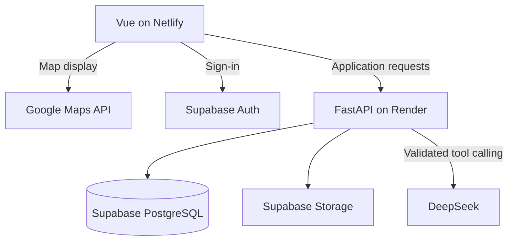

# Akses Campus — Team and Agent Onboarding

Last updated: 16 October 2026 (Asia/Kuala_Lumpur)

## Start here

Akses Campus is the current working direction for a three-person, 24-hour community hackathon project. The confirmed pilot is IIUM Gombak, initially in English. The PWD track is broad; the initial user journey focuses on wheelchair access to campus buildings. Future campuses should be supported by the data model without expanding the current pilot scope.

**Pitch:** Help students check campus accessibility conditions before visiting, using facility-level evidence, an AI assistant, and community reports with corroboration and resolution history.

Read this file before planning or implementing features. It records the discussion so teammates and future agents can continue without reconstructing the chat. The user's latest instructions and any applicable `AGENTS.md` take precedence.

Read [COLLABORATION.md](COLLABORATION.md) for file ownership, branches, PRs, and cross-area handoffs. Root [AGENTS.md](AGENTS.md) provides matching agent instructions. Shared contracts belong in `contracts/`; database migrations/configuration belong in `supabase/`.

The user requested an explicit local chatbot demo before database integration. `DEMO_DATA_ENABLED=true` in development supplies three fictional, labelled building records. AI responses remain real; API/provider failures are not masked. The committed default is off, production rejects it, and real adapters take precedence. See [backend demo instructions](backend/README.md#local-chatbot-demo-without-supabase). No database-owned files or real campus records are changed by this mode.

## Current status and decisions

- The team has three members and a 24-hour build window.
- The chosen working track is Persons with Disabilities (PWD), narrowed to wheelchair access.
- Akses Campus is the working project name. IIUM Gombak and English-only initial UI are confirmed; exact collection boundaries remain to be chosen.
- Backend foundation, building discovery, Supabase JWT verification, DeepSeek tool orchestration, and signed-in community routes/configurable trust functions are implemented with 135 passing tests. Real database adapters, provider configuration, and numerical trust-policy activation remain pending; disconnected routes return explicit 503s. Fictional runtime data is available only through the explicit development demo flag; no paid AI calls, database-owned changes, or frontend changes were made during automated verification. [BACKEND_HANDOFF.md](BACKEND_HANDOFF.md) records verification and remaining integration work.
- The team prefers Python, is comfortable using JavaScript, and proposed Vue with Tailwind. The implementation baseline below adopts Vue 3, Tailwind, FastAPI, SQLModel, PostgreSQL, and Google Maps from the subsequent stack discussion.
- Hosting is agreed: Netlify Free frontend, Render Free Python backend, and Supabase PostgreSQL/Auth/Storage. Accounts, credentials, and deployments are not configured yet.
- The user selected DeepSeek and has approximately US$2 credit. Recommended model: `deepseek-flash` with thinking disabled. Search and place questions are MVP scope; conversational report drafting is stretch scope. Implemented backend schemas are documented in contracts/chat.md; teammate integration review remains pending.
- Public browsing and signed-in reporting/voting are confirmed. Community voting replaces the previous dedicated reviewer design. Internal reliability scores influence bounded vote weights; the algorithm remains experimental and must be specified before coding.
- The team will collect initial building observations by walking around campus. No intended-user interviews have happened yet.
- Team ownership is confirmed by function: teammate 1 frontend, the user primarily backend, teammate 3 database. Names remain unspecified.
- The user reports no submission artifact is required. The project still needs a rehearsed demo and pitch; pitch duration and event deadline remain unspecified.
- The MVP, role split, and schedule below are recommendations from the planning discussion, not completed work.
- Campus data coverage, access to intended users, and the current state of IIUM's existing accessibility map remain unverified.

## Stack and architecture

| Layer | Baseline | Responsibility |
| --- | --- | --- |
| Frontend | Vue 3, Vite, JavaScript, Vue Router | Map/list browsing, filters, details, chat, report forms, community voting |
| Styling | Tailwind CSS with its Vite plugin | Responsive layout, consistent components, visible interaction states |
| Maps | Google Maps JavaScript API with Advanced Markers | Base map and custom facility/barrier markers |
| Backend | Python, FastAPI, Pydantic | Input validation, queries, authentication, and report lifecycle |
| Database access | SQLModel | Python models and database queries |
| Database | Supabase PostgreSQL | Campuses, buildings, observations, reports, votes, private reliability records, and history |
| Authentication | Supabase Auth | Sign-in for contributors; backend validates identity and restrictions |
| Photos | Supabase Storage | Image files; references and metadata in PostgreSQL |
| AI assistant | DeepSeek, recommended `deepseek-flash`, non-thinking mode | Search records, explain evidence, and return structured map/list results |
| Hosting | Netlify Free frontend, Render Free backend | Separate deployments from one repository |

Use JavaScript unless the team explicitly chooses TypeScript. Start with Vue composables for shared state. Introduce additional libraries only when they resolve an actual need.

### Application boundaries

Use a single repository and one Python backend, organized into feature modules. The browser calls Google Maps directly for map display and calls FastAPI under `/api` for application data and chat. Database and AI credentials stay on the backend. The browser never connects directly to PostgreSQL or invokes privileged model tools itself.



Development: run Vite and FastAPI separately, with Vite proxying `/api` to FastAPI. Production: Netlify serves the Vue build; Render serves FastAPI. Configure `VITE_API_BASE_URL` and an explicit backend CORS allowlist. Configure Supabase Auth redirect URLs for actual frontend origins. Netlify needs a client-side route fallback; API failures must not become frontend HTML responses. This replaces the earlier single-origin FastAPI-hosted frontend plan. Netlify Functions will not host Python.

Use Supabase PostgreSQL for the deployed shared prototype and Supabase Storage for photos. Do not store persistent data on Render Free's ephemeral filesystem. SQLite is a local development fallback only. Verify that reports survive backend restarts. Render Free sleeps after 15 minutes without inbound traffic and can take about a minute to wake; rehearse and check health before presenting. Supabase Free can pause inactive projects; check provider allowances before the event. References: [Render Free](https://render.com/docs/free), [Supabase pricing](https://supabase.com/pricing), [Netlify Functions](https://docs.netlify.com/build/functions/overview/).

### Repository structure

These paths exist. Frontend subdirectories contain `.gitkeep` files. Backend `main.py`, `config.py`, `schemas.py`, and `routers/health.py` implement the foundation; `models.py` and `database.py` remain database-owned placeholders. Backend manifests and tests are present; see [backend README](backend/README.md) for verified startup commands. Frontend startup tooling is pending.

```text
frontend/
  README.md
  .env.example
  src/
    components/       # Map, markers, filters, bottom sheet
    views/            # Explore, reports, sign-in, community
    composables/      # Shared reactive state and logic
    services/         # API client
backend/
  README.md
  .env.example
  app/
    __init__.py
    main.py
    config.py
    models.py
    schemas.py
    database.py
    routers/          # Places, reports, votes, authenticated identity, chat
    services/         # Vote aggregation, trust rules, report transitions, AI tools
  requirements.in
  requirements.txt
  requirements-dev.txt
  pytest.ini
  tests/
seed/README.md
supabase/            # Database-owned; migrations directory is currently empty
contracts/           # Shared interface decisions; backend owner is single editor
.gitignore
AGENTS.md
COLLABORATION.md
README.md
onboarding.md
```

### Initial API contract

| Endpoint | Purpose | Access |
| --- | --- | --- |
| `GET /api/places` | List places with facility filters | Public |
| `GET /api/places/{id}` | Details, observations, evidence, and active warnings | Public |
| `POST /api/reports` | Submit an unverified report | Signed-in contributor, with validation and abuse controls |
| `POST /api/reports/{id}/votes` | Record/update one member's corroborating or disputing vote | Signed-in eligible member; no self-vote |
| `POST /api/reports/{id}/clearance-observations` | Record that a barrier appears cleared, with evidence | Signed-in contributor; resolution requires community aggregation |
| `POST /api/chat` | Interpret a campus question and return grounded answers, cards, and map/list actions | Public, with request limits |

Agree request/response schemas before splitting implementation. A required facility filter matches `yes`, not `unknown`. Keep matching buildings visible with active warnings. Enforce vote eligibility and status rules on the backend; clients cannot directly set report status or reliability. Record votes, aggregation changes, and history consistently in database transactions.

Use Supabase Auth for account sign-in. FastAPI must validate token signature, issuer, audience, expiry, and account identity using supported Supabase verification methods; never trust a client-supplied user ID or decode a token without verification. Store reputation outside publicly readable profiles and restrict database/storage access appropriately. Supabase's publishable key can be in frontend configuration; database credentials and service-role keys cannot.

## Google Maps integration and UI reference

The user supplied a Toilet Finder screenshot as a layout reference: a full map, custom markers, selected marker emphasis, a bottom detail sheet, search/location controls, a list toggle, and bottom navigation. Adapt the interaction pattern to Akses with original assets and facility/report content.

- Render one primary marker per building. Keep entrance location/side, photos, and optional entrance coordinates inside building details. Selecting a marker and its list item must open the same details; a building-centre marker alone must not imply an accessible entrance there.
- Store observations and reports in our database. Markers do not automatically publish listings or reports to public Google Maps.
- Preserve Google attribution and keep controls clear of it. Provide icons plus labels and an accessible list alternative.
- Configure a Google Cloud billing account, enable Maps JavaScript API, create a browser API key, and configure a map ID for Advanced Markers.
- Browser map keys are visible by design: restrict them to approved website origins/referrers and the required API. Keeping the key in an environment file does not make it secret after a frontend build.
- Pricing checked on 16 October 2026: Dynamic Maps has 10,000 free monthly loads and then US$7 per 1,000 additional loads through 100,000 monthly loads. Taxes and other APIs are excluded; usage is aggregated across projects on the billing account. Recheck before launch.
- Adding custom markers, panning, and zooming do not create extra map loads. Creating/recreating the map does. Keep the map instance stable when filters change.
- Places, geocoding, and routes have separate pricing. For the MVP, use stored campus coordinates and our own search/filter data.
- Set available quotas and billing alerts. Alerts notify; they are not a spending cap. The accessible list should remain usable if Google Maps fails.

References: [Advanced Markers](https://developers.google.com/maps/documentation/javascript/advanced-markers/overview), [setup](https://developers.google.com/maps/documentation/javascript/advanced-markers/start), [pricing](https://developers.google.com/maps/billing-and-pricing/pricing), [map-load FAQ](https://developers.google.com/maps/faq), [API key restrictions](https://developers.google.com/maps/api-security-best-practices).

## Problem and intended users

A wheelchair user planning a campus visit needs to know whether a destination meets their requirements and whether the information still reflects current conditions.

Example question: **“Where can I study nearby with a step-free entrance and an accessible toilet?”**

Primary users for the initial journey are students and visitors who use wheelchairs. Contributors are signed-in community members. Community corroboration replaces dedicated reviewers; no university partnership or authority integration is established. The team has not interviewed intended users, so assumptions remain to validate.

Focus on information and reporting. The application cannot remove physical barriers or guarantee that a visit will be possible.

## Judging rubric

| Category | Weight | What to demonstrate |
| --- | --- | --- |
| Problem Statement & Impact | 15% | A specific community need, supported by user feedback where possible |
| UI/UX & Accessibility | 20% | Intuitive navigation and an accessible end-to-end experience |
| Innovation & Technology Integration | 20% | Useful integration of modern technology such as APIs, cloud services, or AI |
| Technical Execution & Code Quality | 20% | A stable, functional prototype with understandable code |
| Ethical Standards & Value Alignment | 5% | Privacy, safety, respectful treatment, and alignment with IIUM values |
| Presentation & Live Pitching | 20% | A clear story, working live demo, and credible Q&A |

UI/UX, execution, and pitching together represent 60%. Prioritize a polished working flow. The rubric lists AI, APIs, and cloud services as examples; it does not require all three.

## MVP scope

Build an IIUM Gombak pilot with approximately 10–15 building records, collected by the team on campus. Prioritize the task of finding a suitable study destination. Label any fictional demo records separately from real observations.

1. **Browse:** Show locations on a map and in an accessible list.
2. **Filter:** Support step-free entrance, accessible toilet, and designated parking.
3. **Inspect:** Show specific facility observations, photos when available, information source, and last checked date.
4. **Report:** Let a contributor submit a temporary barrier or outdated-information report.
5. **Corroborate and resolve:** Let signed-in members submit weighted community votes and clearing observations, with derived status and visible history.
6. **Ask the assistant:** Search campus records conversationally and ask place-specific questions, with source cards and synchronized map/list results.

The community reporting workflow and data-grounded assistant are the proposed demo strengths. If time becomes tight, simplify map interactions and visual extras before removing the complete report lifecycle.

### Facility collection definitions

- **Step-free entrance:** record observed steps/barriers and the specific entrance side/location, photo, and check date. Record lift dependency if access to the destination needs one.
- **Accessible toilet:** record floor/location, signage and observed features, evidence, and date. Signage alone does not establish formal compliance or universal suitability.
- **Designated parking:** record marked spaces, location, and the observed connection toward the entrance; keep unobserved details unknown.
- All fields support yes/no/unknown; observations are not formal certification. Never infer unknown features from photographs without an actual checked observation.
- Active warnings do not remove a building matching its recorded facility filters. Show warnings prominently in cards, details, and AI answers.

### Explicitly outside the initial MVP

- Accessible route planning, turn-by-turn navigation, or indoor positioning.
- Volunteer dispatch, emergency assistance, appointments, or job listings.
- City-wide coverage or a complete solution for every disability group.
- Automatic accessibility certification from photos or AI.
- University systems integration, unless access is actually obtained.
- Advanced fraud detection/ML, social networking, and gamification. A small configurable community-trust algorithm is in scope.

### Community verification and trust

The user wants a Waze-like, community-based system with internal reliability scores and greater voting weight for trusted contributors. The following are recommended implementation boundaries; numeric thresholds, bootstrap rules, and scoring updates remain to be finalized before coding.

- Public browsing; Supabase sign-in required for reports and votes. Require distinct authenticated voters, a unique user/report vote, and no self-voting.
- Give new accounts neutral weight, a short reporting guide, and conservative contribution limits. Do not label new users untrustworthy merely because they are new.
- Cap established users' weight advantage and require a minimum number of distinct voters for corroboration. One high-score member cannot establish a report alone.
- Keep reliability scores private, while disclosing that contribution history affects weighting. Explain temporary restrictions; do not silently discard all low-score users' reports.
- Rate-limit duplicates, rapid submissions, and suspicious voting. Community consensus is not ground truth and does not prevent coordinated accounts from manipulating results; disclose the prototype's limits.
- Conflicting evidence yields a disputed state. Do not equate minority disagreement with proven false reporting. Treat automatic penalties based only on vote agreement as unvalidated.
- Preserve report evidence and audit history. Capture vote-weight snapshots or versioned calculations so status changes are explainable and repeatable.
- Collect clearing observations separately. A barrier that is clear later does not make its earlier report false; do not penalize the original reporter for changing conditions.
- Report freshness/expiry rules, account recovery from restrictions, score bootstrap, and resistance to collusion need explicit rules. Unsupported or stale reports must not be silently presented as current corroborated facts.
- UI wording: unverified, community corroborated, disputed, resolved. Never use community votes as a guarantee of safety or formal accessibility certification.

Implement eligibility checks, duplicate protection, capped weights, deterministic aggregation, and visible history first. Use seed accounts only in clearly labelled demonstrations. Do not claim a reputation system is validated through seeded consensus.

### AI chatbot scope and implementation contract

The backend chatbot and place-query API are implemented and reuse the same filtering rules. Connect the real database adapter and frontend next. It should help users complete campus decisions and visibly interact with the map.

| Capability | Tool | Expected behavior |
| --- | --- | --- |
| “Find somewhere to study with a step-free entrance and accessible toilet” | `search_places` | Query stored records, return matching places and editable interpreted filters, update map/list |
| “Does this building have step-free access?” | `get_place_details` | Return observations, evidence, check dates, and active report status; clarify ambiguous place names |
| “The library ramp is blocked” | `prepare_barrier_report` (stretch) | Prepare an editable draft; ask the user to review and explicitly submit through the ordinary report flow |

Architecture: `Vue chat panel -> POST /api/chat -> AI proposes an allowed tool -> backend validates and executes it -> database evidence -> grounded answer and structured UI results`.

Implemented request fields are `message`, bounded `history`, and optional `selected_place_id`. Responses contain `data_mode`, `answer`, `status`, `places`, `sources`, `applied_filters`, and `total_matches`; see [the chat contract](contracts/chat.md) for limits. Report drafting remains unimplemented. The frontend should render markers and source cards from validated backend records rather than parsing model prose.

Implementation rules:

- Allow only named tools with explicit schemas. Validate arguments, place IDs, result limits, and campus scope on the backend. Do not let the model execute arbitrary SQL or access credentials.
- Reuse place-query and report-validation services; do not create conflicting AI-specific accessibility rules.
- Every factual place answer must be supported by returned observations or reports. Source cards show place name, facility values, available evidence, observation date, and verification state.
- Missing data stays unknown. Never invent accessibility, timestamps, photos, or guarantees, and never present an unverified barrier as confirmed.
- If no complete match exists, say so; offer clearly labelled partial matches with missing/unknown requirements or ask what the user would relax. Never silently change required filters.
- Treat retrieved descriptions, reports, and chat text as untrusted input. They cannot override tool permissions or system instructions.
- Keep writes outside the initial chatbot tools. Report drafting does not submit anything. Explicit signed-in submission uses `POST /api/reports` and starts unverified. The AI cannot vote, change reputation, or set status; the backend derives community status.
- Keep manual filters and details usable during AI failures. Show an explicit system error and retry option, preserving the query. Do not invent default accessibility answers or simulate a successful AI response. Distinguish an AI outage from a backend outage.
- Limit input/context size, tool iterations, result count, request rate, and provider timeout. Use DeepSeek's recommended `deepseek-flash` with thinking disabled. The user's approximately US$2 balance supports controlled testing/demo usage; AI charges are separate from map charges. Current model/rate references, checked 16 October 2026: [pricing](https://api-docs.deepseek.com/quick_start/pricing/), [thinking mode](https://api-docs.deepseek.com/guides/thinking_mode/). Recheck before integration and log token usage without logging sensitive raw messages.
- Keep `AI_API_KEY` backend-only and configure `AI_MODEL` there. These are implemented backend settings. Do not send disability histories, exact user location, or unrelated records to the provider. Avoid persistent raw chat storage by default; document any retention decision.
- Keep the chat panel keyboard accessible, provide a labelled input and announced response/loading state, and preserve focus when map results change.

No vector database, model training, agent framework, or open-ended web browsing is required for this MVP. Structured queries over the small campus dataset are sufficient.

## Core demo and acceptance criteria

**Demo story:** A student asks for a study space with a step-free entrance and accessible toilet. Matching building markers and evidence cards appear, including current warnings. A signed-in student submits a barrier report; distinct community members corroborate it, then later clearing observations lead to resolution. Chat-based report drafting is optional.

The MVP is demo-ready when:

- A user can find a location through the list and filters without relying on the map.
- Place details distinguish **yes**, **no**, and **unknown** for each facility.
- Known observations show their source and observation/check date; unknown dates remain unknown.
- A submitted report persists after refresh and appears on the relevant location.
- New reports are visibly unverified and do not silently overwrite established facility information.
- Authenticated community votes derive status and preserve history; unsigned requests, self-votes, duplicate votes, and client-set status/score changes are rejected.
- Weight caps and distinct-voter thresholds work, including an all-new-user bootstrap and conflicting-vote cases.
- A clearing event does not reduce the original reporter's reputation merely because the barrier is now gone.
- The core flow works with a keyboard and has readable labels, contrast, and focus indicators.
- Loading, empty results, failed submissions, and unavailable external services have understandable states.
- A chatbot search returns database-backed results, visible interpreted filters, and matching map/list records.
- Place answers show sources, unknown information, and unverified warnings correctly; ambiguous names trigger clarification.
- The assistant cannot execute unsupported tools or change report status, including when retrieved text contains instructions.
- The normal search/list remains functional when the AI times out or fails.
- Demo data is clearly identified, and the team has rehearsed the full flow on the deployed build.

### Outage and presentation fallback

Rehearse on Netlify/Render/Supabase and check backend health before the pitch to account for free-host cold starts. Keep a working local setup and a clearly identified recorded successful demo as backups. Cached building records, if implemented, must show their age; do not fabricate fresh reports or chat responses. Preserve unsent input and never mark a failed report/vote submission successful. English is the initial UI language; localization is future scope.

## Suggested data model

Adapt this to the chosen stack; it is a design starting point, not an existing schema.

| Entity | Suggested fields |
| --- | --- |
| Campus | ID, name, region; IIUM Gombak initially |
| Place/building | ID, campus ID, name, category, area, building coordinates, entrance details/optional coordinates, description, demo-data flag |
| Facility observation | Place ID, facility type, yes/no/unknown value, observation date, source, evidence reference, verification status |
| Barrier report | ID, place ID, author ID, barrier type, description, optional photo, observed time, submitted time, derived status |
| Community vote | Report ID, voter ID, stance, weight snapshot/version, timestamp; unique voter/report |
| Clearance observation | Report ID, author ID, evidence, observed/submitted times, corroboration state |
| Report action | Report ID, previous/new state, aggregation version, timestamp, explanation |
| Contributor reliability | Auth user ID, internal score/signals, restrictions, calculation version; private |

Proposed states are `unverified`, `community_corroborated`, `disputed`, and `resolved`. Community votes derive corroboration/dispute; corroborated clearing observations derive resolution. Specify transition and freshness rules before implementing. An individual contributor cannot directly resolve or erase a report. Reopening and abuse-removal behavior remain to be designed.

Keep permanent facility observations separate from temporary reports. A blocked ramp is a current warning; it does not mean the building never had a ramp.

## Accessibility, privacy, and data integrity

- Use semantic controls, explicit form labels, keyboard support, meaningful alt text, and visible focus.
- Provide text labels alongside status colors and map markers.
- Do not describe a location as universally accessible based on one overall score. Present specific facilities so people can decide for themselves.
- Do not require users to disclose a disability, medical history, or exact live location.
- Request location permission only for an optional nearby feature; browsing must work without it.
- Avoid identifiable faces and personal information in evidence photos. Validate uploads if photo submission is implemented.
- Distinguish unverified, corroborated, disputed, and resolved reports. Community corroboration describes agreement over evidence; it is not a guarantee or formal accessibility certification.
- Use fictional or clearly labelled sample data unless real campus observations have been checked. Do not invent photos, timestamps, testimonials, or university endorsements.
- A report is submitted to this prototype. Do not imply that campus authorities have received it without a real integration.
- Express IIUM value alignment through dignity, truthful information, responsible handling of data, and mutual assistance.

## Related work and evidence

The links below were researched during planning. Product capabilities can change. The comparison does not establish that other systems lack freshness indicators or reporting features.

| Work | Relevant capabilities or findings | Lesson for this project |
| --- | --- | --- |
| [Wheelmap](https://news.wheelmap.org/en/) | OpenStreetMap-based crowdsourced wheelchair accessibility map, traffic-light ratings, toilet information, and photos | Mapping and community ratings are established ideas |
| [AccessNow](https://accessnow.com/blog/whats-new-in-the-accessnow-app/) | Accessibility discovery, ratings, facility features, photos, and lightweight contributions; linked update dated December 2025 | Feature-level information and photo contributions alone are insufficient differentiation |
| [Google Maps Accessible Places](https://blog.google/products-and-platforms/products/maps/wheelchair-accessible-places-google-maps/) | Official 2020 announcement describes entrance, seating, restroom, and parking accessibility information | Prepare a concrete answer to “Why not Google Maps?”; this historical announcement does not prove current local coverage |
| [AccessAble university guides](https://www.accessable.co.uk/inspire-me/heading-to-uni) | Detailed university access guides covering learning spaces, accommodation, parking, and toilets | Campus guides already exist; useful facility detail matters |
| [Project Sidewalk](https://makeabilitylab.cs.washington.edu/project/sidewalk/) | Research on collecting sidewalk accessibility information using crowdsourcing, imagery, and computer vision | Contributor guidance and data quality are substantive technical problems |
| [IIUM accessibility initiative, 2023](https://news.iium.edu.my/enhancing-iium-accessibility-empowering-students-of-all-abilities/) | Landscape Architecture and the Disability Service Unit collaborated on accessibility improvements; students prepared a campus accessibility map described as in progress at the time | Do not claim to create IIUM's first accessibility map; investigate the current initiative and potential complementarity |
| [UiTM wheelchair accessibility mapping project, 2024](https://ir.uitm.edu.my/id/eprint/101768/) | Unpublished student project focused on a mobile accessibility map for UiTM Seri Iskandar | A Malaysian campus map is also an existing project direction; the abstract does not establish outcomes |
| [Saha et al., Project Sidewalk, CHI 2019](https://makeabilitylab.cs.washington.edu/media/publications/Saha_ProjectSidewalkAWebBasedCrowdsourcingToolForCollectingSidewalkAccessibilityDataAtScale_CHI2019.pdf) | Deployment research identifies concerns around reliability, maintenance, and whether labels reflect users' needs | Show evidence, dates, review state, and clear definitions |
| [Chan et al., Physical accessibility in Malaysian higher educational institutions](https://journals.sagepub.com/doi/10.1177/00208728221094417) | Abstract reports a survey of 52 students and interviews with 14, partial dissatisfaction with facilities, and differing perspectives across disability groups; online 2022, issue 2023 | Supports investigating the local problem, not claiming that an app fixes physical infrastructure; only the abstract was reviewed |

### Defensible innovation claim

“We are prototyping a campus-focused workflow for checking accessibility evidence and keeping temporary barrier reports visible, reviewed, and resolved.”

This is a proposed project angle to validate, not a proven market gap. Avoid claims such as “the first accessibility map,” “competitors have no reporting,” or “AI guarantees accessibility.”

## Suggested responsibilities and schedule

Assign actual names once the team agrees. Balance tasks against the team's strengths.

File ownership is specified in [COLLABORATION.md](COLLABORATION.md#ownership). Teammate 3 owns `backend/app/models.py` and `backend/app/database.py` as exceptions to backend directory ownership. The user is the integration owner and shared-contract editor. These are coordination rules, not technical file locks.

| Owner | Main responsibility |
| --- | --- |
| Teammate 1 | Frontend: accessible Vue/Tailwind UI, map/list, details, chat/source cards, sign-in and voting screens |
| User | Backend: FastAPI, identity validation, reports/votes, trust aggregation, DeepSeek tools, Render deployment |
| Teammate 3 | Database: Supabase schema/migrations, constraints, Auth/Storage setup, seed/import workflow, and data policies |

Suggested 24-hour allocation:

- **Hours 0–2:** Validate the problem, check the existing IIUM map, agree scope and stack, sketch the demo, and define shared data/API contracts.
- **Hours 2–6:** Establish the application, seed data, initial deployment, and a working place list/details flow.
- **Hours 6–14:** Build filters, map, signed-in reporting/voting, deterministic aggregation, and persistence. Once place queries work, connect chatbot search/details tools. Integrate continuously.
- **Hours 14–18:** Complete chatbot source cards and map synchronization, evidence/status presentation, accessibility, and error handling. Add report drafting only if the MVP is stable.
- **Hours 18–24:** Freeze features, verify the deployed demo, fix material issues, prepare slides, and rehearse Q&A.

## Engineering and future-agent guidance

1. Inspect the current repository and applicable `AGENTS.md` before editing. This file describes the initial state and may become outdated.
2. Check the latest user direction. Use the documented stack as the implementation baseline; optional features, provider accounts, and external integrations are not implemented merely because they are listed here.
3. Preserve the agreed Vue/Netlify, FastAPI/Render, Supabase, and DeepSeek architecture. Finalize authentication configuration and trust rules rather than reintroducing dedicated reviewer workflows or the earlier single-origin deployment plan.
4. Preserve teammates' changes. Agree file ownership when work overlaps and keep shared data contracts consistent.
5. Build the smallest working vertical flow first: stored building -> list/details -> authenticated report -> distinct community votes -> derived status/history.
6. Keep backend secrets out of source control and browser bundles. A restricted browser Google Maps key is intentionally public. Document environment variable names without real values in committed examples.
7. Validate report input and authorization on the trusted backend, not only in client UI controls.
8. Verify meaningful behavior: unknown facility filtering, warning retention, persistent reports, authenticated contributions, vote uniqueness/caps/thresholds, clearing events, private reliability, keyboard flow, grounded chat, invalid tool rejection, and explicit outage states.
9. Use the chosen framework's standard build/lint checks. Document actual commands once tooling exists; do not claim checks passed unless run.
10. Record setup, seed/reset procedure, deployment details, and known limitations in the repository as implementation progresses.
11. Keep this onboarding accurate as decisions change. Clearly separate completed work, remaining work, and future ideas.
12. Do not contact users or university representatives, publish externally, or claim institutional approval without the team's authorization. Preparing interview questions and pitch materials is appropriate.

## Next actions

- Use the confirmed role split and IIUM Gombak pilot; finalize field-collection boundaries and experimental trust/transition rules.
- Frontend owner: scaffold Vue and review [building contract v0.1](contracts/places.md). Database owner: provide the repository adapter over your models/sessions. Backend owner: wire that adapter into the implemented `/api/places` routes after the handoff. Environment examples and backend setup commands exist.
- Configure a restricted Google Maps browser key and map ID; deploy an early map/list prototype.
- Check the current IIUM accessibility map and reporting process.
- Seek feedback from a wheelchair user or relevant campus representative through a team-authorized approach.
- Agree the three facility definitions and collect a small, honestly labelled dataset.
- Define building/entrance, report, vote, clearance, and private reliability contracts with the database teammate.
- Configure Supabase Auth/Storage, Netlify, Render, and backend-only DeepSeek credentials; finalize bounded tool schemas and the chat response contract.
- Implement and deploy the core flow, then integrate chatbot search/details over the same data services.

## Pitch and Q&A preparation

Lead with one student's decision, demonstrate the complete workflow, and explain what was actually built.

Prepare answers to:

- **Why not Google Maps or AccessNow?** Show the campus-specific evidence and reporting workflow. Acknowledge existing tools and avoid unverified claims about their limitations.
- **How do you know information is correct?** Explain sources, observation dates, unknown values, and community corroboration/disputes, including the prototype's limits.
- **Who maintains it after the hackathon?** Explain community observations, weighted corroboration, dispute handling, and recurring checks; no campus partner is committed.
- **What is the AI doing?** It interprets campus questions, calls permitted search/details tools over stored records, and returns evidence-backed cards and map results. Report drafting, if implemented, requires explicit submission. Demonstrate only capabilities that actually work.
- **What did you validate?** Report actual interviews, observations, and tests. If none occurred, say so and explain the next validation step.
